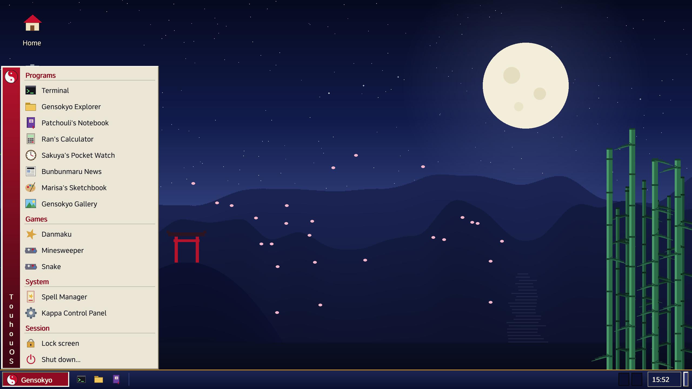
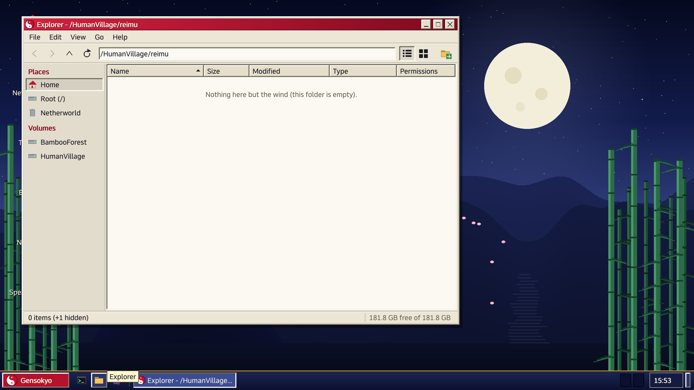

# TouhouOS

A Touhou-themed operating system for x86-64 PCs, written from scratch in C and a little assembly: UEFI loader, kernel, C library, shell, window system, desktop, a web browser, and its own TLS, TrueType and JavaScript engines. Every part was written for this project from public specifications (RFCs, the Intel manuals, the ELF and TrueType specifications, the WHATWG and ECMA standards).

> **Status, November 2026: almost ready to play TH01 to TH05.** The PC-98 emulator now runs all five original games on its 386 model: **TH01's first stage plays** (the orb bounces, the score counts), TH02, TH04 and TH05 reach their first stage, TH03 reaches its versus screen, and the games' FM music is synthesized by an OPNA model. What is left is the desktop application that puts the emulator in a window, with keys, sound and saved changes. **No game data is included or ever will be**: you bring your own copies of the disk images ([docs/PC98.md](docs/PC98.md)).

<p>


</p>

Screenshots of the real thing, taken from a Dell OptiPlex (Core i5-7500) over the system's own VNC server. Everything is themed (the trash is the Netherworld, processes are "spells", a page fault is a boundary violation), but the plain technical fact always stays readable next to the joke: see [docs/THEMING.md](docs/THEMING.md).

## What is in it

| Area | What exists |
|---|---|
| **Boot and kernel** | A UEFI loader and a higher-half x86-64 kernel ("Gensokyo"): preemptive scheduler, virtual memory, ring-3 processes, threads, signals, pipes, ptys, sockets, a VFS. An update system that pushes a new kernel over ssh, tries it, and falls back to the previous one by itself; a hardware watchdog; wake on LAN. |
| **Drivers** | PCI, SATA (AHCI), NVMe, virtio, xHCI USB (hubs, keyboards, mice, sticks), PS/2, Intel HD Audio and AC'97, several network cards (virtio, e1000/e1000e and the Intel PCH cards, Realtek), framebuffer. |
| **Storage** | FAT32 (read-write), NTFS (read-only, BitLocker with a clear key), tmpfs, procfs, devfs. It only ever mounts the volume labelled `HUMANVILLAGE`; every other disk stays read-only. It installs next to Windows without touching its partitions. |
| **Network** | TCP/IP in the kernel, DHCP, DNS, SNTP at boot, an ssh server and client (sftp, scp, forwarding), a VNC server, **TLS 1.3 and 1.2 with its own cryptography**, an HTTP/HTTPS client. |
| **Userland** | Its own C library (`libgap`), shell (`gapsh`), about 140 command-line tools in one multicall binary (`kappabox`) with manual pages, `vi`, `awk`, `diff`, `bc`, and its own C compiler, linker, archiver, assembler and `make` (it can rebuild its own userland on itself). |
| **Desktop** | The Fairies window server, the Kappa toolkit, the HakureiDE desktop, a login screen, and applications: Explorer, Notebook, Sketchbook, Gallery, Calculator, Pocket Watch, Spell Manager (task manager), Control Panel, a terminal, and a few games. Text is set in a TrueType rasteriser written for the project. |
| **Web** | **Kyouko's browser** over *Hatate*, a from-scratch HTML5/CSS engine (block, inline, flex, grid and table layout, forms, images) and *Kosuzu*, a from-scratch JavaScript engine (ES2024 without modules so far; not yet connected to the browser). It loads real HTTPS pages and refuses bad certificates with no "continue anyway". |
| **PC-98 emulation** | A freestanding 386/486 model checked against 1.76 million single-step test vectors, a high-level BIOS, the graphics display, an FM sound model; the five games run as described above. |

Tested by about 400 scripted QEMU tests and several hundred host-side tests. It boots to the desktop on real hardware too; what was checked on the first machine, and what that showed, is in [docs/HARDWARE_AUDIT.md](docs/HARDWARE_AUDIT.md).

## Where it is going

Run Linux programs natively (a syscall layer written from the specifications, then Windows programs, benchmarked on Windows-era games: [docs/COMPAT.md](docs/COMPAT.md)), a compressed boot image, bigger hardware coverage (more drivers, a bootable ISO that runs from memory and touches nothing: [docs/HARDWARE_BREADTH.md](docs/HARDWARE_BREADTH.md)), and the browser's JavaScript. [docs/ROADMAP.md](docs/ROADMAP.md) and [docs/STATUS.md](docs/STATUS.md) have the detail.

## Using it

[docs/USER_GUIDE.md](docs/USER_GUIDE.md) is the guide for someone in front of the desktop: the applications, the keyboard shortcuts, the terminal and the shell, where files live (and what survives a restart), accounts and logging in, shutting down, and the boot options. On the system itself, `man gensokyo` is the map and every command has a manual page.

## Building

Needs LLVM/Clang (`clang`, `ld.lld`, `lld-link`, `llvm-objcopy`, `llvm-ar`), NASM, QEMU with the OVMF UEFI firmware, and Python 3 (3.11 or newer) with Pillow and numpy.

```powershell
python tools/build.py          # loader + kernel + userland + initrd -> build/esp   (or .\tools\build.ps1)
```

The tooling was written on Windows (PowerShell, LLVM, NASM and QEMU in their default install places). For building on Linux, see [docs/LINUX.md](docs/LINUX.md).

## Running it in QEMU

```powershell
python tools/qemu.py run                         # a QEMU window; the kernel log goes to this terminal (or .\tools\run-qemu.ps1)
python tools/qemu.py run --cmdline "text"        # a text console instead of the desktop
python tools/qemu.py boot --until "REGEX" --shot build/shot.png    # headless: wait for a log line, save a screenshot
```

Without a disk everything, the home folders included, lives in memory and is gone when QEMU stops. For a home that persists, make a data disk with a `HUMANVILLAGE` volume; `tools/qemu.py` attaches `build/disk.img` when it exists:

```powershell
python tools/mkdisk.py build/disk.img --size 300M --no-esp
```

## Running it on a real PC

Read [docs/REAL_HARDWARE.md](docs/REAL_HARDWARE.md) first. `python tools/mkimage.py --zip` builds a GPT disk image with a small boot partition and a FAT32 partition labelled `HUMANVILLAGE` that holds the home folders, to be written to a USB stick. Secure Boot has to be off. **The OS never writes to a disk it was not told to**: its default command line makes every SATA and NVMe disk read-only. A bootable ISO is planned.

## Tests

```powershell
python tests/run_all.py [name-prefix]            # the scripted QEMU tests; python tools/suite.py runs them in parallel groups
python tools/hosttest.py discover -s tests/host -p "test_*.py"     # host-side tests of the libraries and tools (they run in WSL or on Linux)
```

## Documentation

[docs/ARCHITECTURE.md](docs/ARCHITECTURE.md) is the map; each subsystem has its own page in [docs/](docs/): [network](docs/NETWORK.md), [TLS](docs/TLS.md), [ssh](docs/SSH.md), [VNC](docs/VNC.md), [updates](docs/UPDATE.md), [the desktop](docs/DESKTOP.md), [TrueType text](docs/TTF.md), [the web engine](docs/WEB.md), [the browser](docs/BROWSER.md), [the JavaScript engine](docs/JS.md), [NTFS](docs/NTFS.md), [the compiler](docs/MCC.md) and its [self-hosting](docs/SELFHOST.md), and the PC-98 emulator ([CPU and machine](docs/PC98.md), [BIOS](docs/PC98_BIOS.md), [graphics](docs/PC98_GFX.md), [sound](docs/PC98_SOUND.md)).

## Notes

* **No game data, ROMs or BIOS images** are in this repository or ever will be. The PC-98 work needs your own, legally obtained disk images, and a font ROM you supply, read at run time.
* **License:** the code, the documentation and the original assets are under the [MIT License](LICENSE). The few third-party items (the bitmap font data derives from DejaVu) and everything that is deliberately *not* here are listed in [THIRD_PARTY_NOTICES.md](THIRD_PARTY_NOTICES.md), and [docs/LICENSING.md](docs/LICENSING.md) explains the rules in one page. Every image built from this tree carries those files.
* The project's own typeface is not published yet (its license is still to be chosen); until it is, the desktop falls back to the built-in bitmap font in a build from this repository.
* Touhou Project is the work of ZUN / Team Shanghai Alice. This is an unofficial fan project, not affiliated with or endorsed by them.
